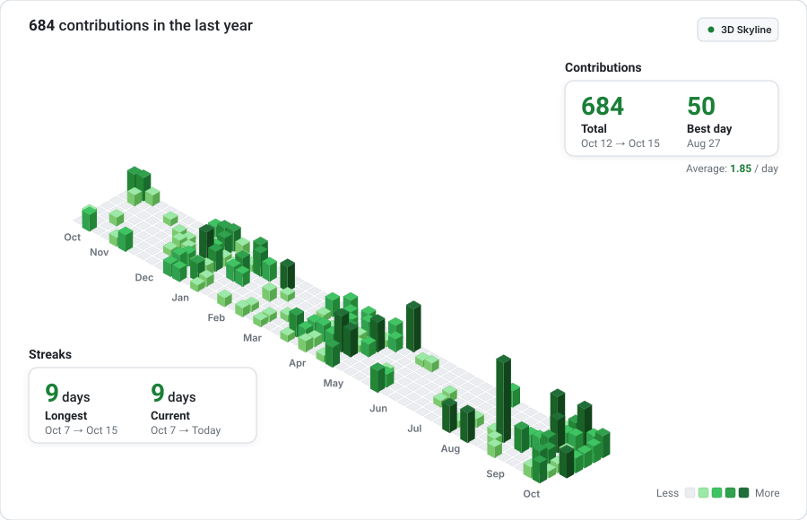
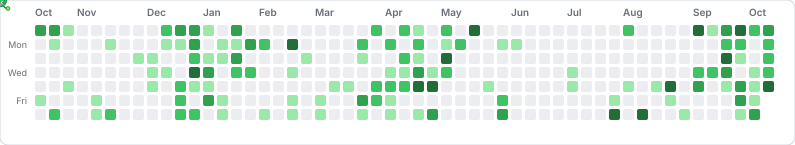

  <!-- Header Banner -->
  

  <!-- Animated Typing Subtitle -->
  

    
  

  <!-- Profile Badges -->
  

    
    
    
    
  

---

### 👨‍💻 About Me

- 🎓 **Education**: Third-year Engineering Student at **Fr. Conceicao Rodrigues College of Engineering (CRCE)**
- ♟️ **Likes & Hobbies**: Big **Chess** player — always down for a blitz or rapid match!
- 💻 **Side Projects**: Love building handy developer tools, like [`Antigravity-Auto-Submitter`](https://github.com/WillyEverGreen/Antigravity-Auto-Submitter) and web scraping utilities like [`acon`](https://github.com/WillyEverGreen/acon).
- 🛠️ **Tech Stack**: Working mainly with TypeScript, JavaScript, Python, Node.js, and Cloudflare Workers.
- 📬 **Let's Connect**: Feel free to reach out to collaborate on projects or play a game of chess!

---

### 🛠️ Tech Stack & Arsenal

| Domain | Technologies & Frameworks |
| :--- | :--- |
| **Languages** |       |
| **Frontend & UI** |      |
| **Backend & Edge** |      |
| **Automation & DevOps** |      |

---

### 🚀 Featured Repositories

| Project | Description | Primary Tech |
| :--- | :--- | :--- |
| **[acon](https://github.com/WillyEverGreen/acon)** ⭐ `45+` | The intelligence layer for any web scraper. Pairs with Scrapling, Playwright, or httpx to crawl smarter. | `Python` `Playwright` `Scrapling` |
| **[Antigravity-Auto-Submitter](https://github.com/WillyEverGreen/Antigravity-Auto-Submitter)** | Fast CLI daemon for Google Antigravity IDE automating tool approvals, CDP monitoring & cleanup. | `JavaScript` `Node.js` `CDP` |
| **[clip](https://github.com/WillyEverGreen/clip)** | Ephemeral text & file sharing platform running on Cloudflare Workers and KV storage. | `TypeScript` `Cloudflare` `Edge` |
| **[HeadLock](https://github.com/WillyEverGreen/HeadLock)** | Self-hosted headless browser API running on Hugging Face Spaces & Docker containers. | `JavaScript` `Puppeteer` `Docker` |
| **[LEGAL_AI](https://github.com/WillyEverGreen/LEGAL_AI)** | AI-powered legal document analyzer, automated contract review, and intelligence extraction. | `TypeScript` `React` `LLMs` |
| **[ReCode](https://github.com/WillyEverGreen/ReCode)** | Algorithmic pattern analyzer and LeetCode solution caching engine with Redis and MongoDB. | `JavaScript` `Redis` `MongoDB` |
| **[CN Firewall Simulator](https://github.com/WillyEverGreen/CN_mini-project-)** | Interactive Layer 3/4 stateful firewall simulator with conntrack inspection & L7 deflection. | `JavaScript` `Networking` `Canvas` |

---

### 🏙️ 3D Contribution Skyline

  

  

    <i>3D isometric activity skyline with month labels along the front edge · Powered by live GitHub data</i>
  

  

    
    
  

---

### 📊 GitHub Activity & Metrics

  <!-- GitHub Readme Stats & Top Langs -->
  <table border="0" cellspacing="0" cellpadding="0">
    <tr>
      <td align="center" valign="middle">
        
      </td>
      <td align="center" valign="middle">
        
      </td>
    </tr>
  </table>

   

  <!-- GitHub Streak in Matching White Theme -->
  

---

### 🐛 Contribution Activity Caterpillar
 
 

   <picture>
     <source media="(prefers-color-scheme: dark)" srcset="./github-contribution-grid-caterpillar-dark.svg" />
     <source media="(prefers-color-scheme: light)" srcset="./github-contribution-grid-caterpillar.svg" />
     
   </picture>
 

---

### 📬 Connect & Collaborate

  
  
  
  

